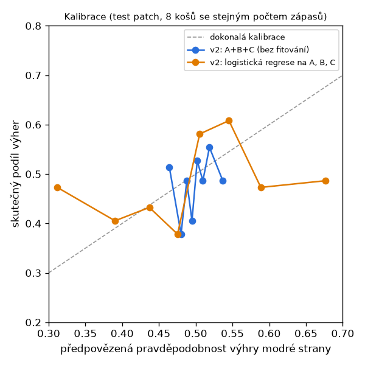
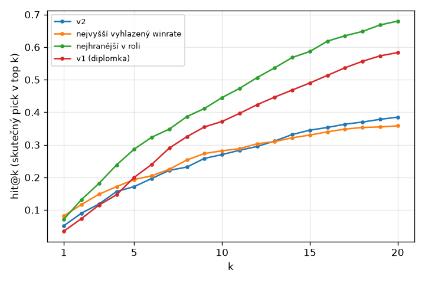
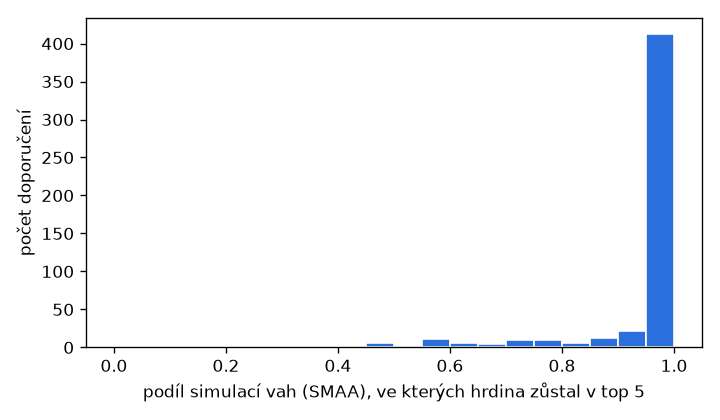

# Výsledky backtestu modelu v2

Vygenerováno 2026-10-25 08:32 UTC příkazem `python -m model.backtest`.
Agregace jen z patche **16.20** (456 zápasů), test na patchi **16.21** (592 zápasů). Testovací zápasy do agregací nevstoupily (kontrola v kódu i v testu).
Testuje se jen draftová část modelu (A, B, C, S, F); osobní kritéria D a E a baseline „nejvyšší mastery“ ne, protože databáze nemá historii hráčů a dnešní mastery by do testu pustilo budoucnost.

## Shrnutí

- **Predikce výhry:** od konstanty se neliší průkazně (AUC 0.529, interval zlepšení log-loss obsahuje nulu).
- **Shoda s picky hráčů proti „nejvyšší vyhlazený winrate“:** v2 je průkazně horší (hit@5 v2 minus baseline -2.2 pb).
- **Shoda s picky hráčů proti „nejhranější v roli“:** v2 je průkazně horší (hit@5 v2 minus baseline -11.5 pb).
- **Shoda s picky hráčů proti „v1 (diplomka)“:** rozdíl není průkazný (hit@5 v2 minus baseline -2.8 pb).
- **Kvalita doporučení:** #1 od v2 byl na novém patchi zhruba stejně silný (rozdíl není průkazný) jako skutečný pick (-0.00 pb).

## 1. Predikce výhry z draftu

| Model | log-loss | Brier | AUC | přesnost |
| --- | --- | --- | --- | --- |
| konstanta (winrate modré strany) | 0.6926 | 0.2497 | 0.500 | 52.0% |
| v2: jen A (síla hrdiny) | 0.6928 | 0.2498 | 0.506 | 50.7% |
| v2: A+B+C (bez fitování) | 0.6916 | 0.2492 | 0.529 | 53.9% |
| v2: logistická regrese na A, B, C | 0.7021 | 0.2541 | 0.539 | 54.2% |

Nižší log-loss a Brier jsou lepší, AUC 0,5 je náhoda. Plán čeká přesnost jen 52 až 60 %.
Zlepšení log-loss A+B+C proti konstantě: +0.0010 (90% interval -0.0022 až +0.0042); kladné = v2 je lepší.
Koeficienty regrese fitované na tréninkovém patchi: A 2.27, B 9.45, C 4.61, intercept -0.028 (koeficient 1 = kritérium je škálované přesně).

## 2. Doporučení: byl skutečný pick mezi doporučenými?

600 draftů z testovacích zápasů: jeden hráč, náhodná část spoluhráčů, 0, 2 nebo 5 známých nepřátel, skutečné bany.

| Metoda | pokrytí | hit@1 | hit@5 | hit@10 | MRR | síla #1 na novém patchi | síla top 5 |
| --- | --- | --- | --- | --- | --- | --- | --- |
| v2 | 97.0% | 5.2% | 17.2% | 27.0% | 0.128 | +0.09 pb | +0.14 pb |
| nejvyšší vyhlazený winrate | 97.0% | 8.2% | 19.3% | 28.2% | 0.151 | +0.13 pb | +0.18 pb |
| nejhranější v roli | 97.0% | 7.2% | 28.7% | 44.5% | 0.189 | +0.43 pb | +0.04 pb |
| v1 (diplomka) | 74.2% | 3.5% | 20.0% | 37.2% | 0.130 | -0.10 pb | +0.05 pb |

- **Pokrytí:** skutečný pick je mezi kandidáty metody (v2 a obě baseline mají stejný pool: hrdinové s aspoň 5 % her v roli na tréninkovém patchi; v1 má vlastní seznam rolí).
- **hit@k** měří shodu s tím, co hráči opravdu vybrali, ne optimalitu (survivorship bias).
- **Síla na novém patchi:** vyhlazený winrate hrdiny v roli spočítaný z testovacího patche (v procentních bodech proti průměru role). Ukazuje, jestli doporučený hrdina byl silný i v datech, která model neviděl.

Rozdíly hit@5 proti v2 (párově na stejných draftech, bootstrap):

- v2 − nejvyšší vyhlazený winrate: -2.2 pb (90% interval -3.8 až -0.5 pb)
- v2 − nejhranější v roli: -11.5 pb (90% interval -14.7 až -8.3 pb)
- v2 − v1 (diplomka): -2.8 pb (90% interval -6.2 až +0.5 pb)

Síla #1 na novém patchi minus síla skutečného picku:

- v2: -0.00 pb (90% interval -0.10 až +0.11 pb)
- nejvyšší vyhlazený winrate: +0.05 pb (90% interval -0.04 až +0.13 pb)
- nejhranější v roli: +0.34 pb (90% interval +0.22 až +0.47 pb)
- v1 (diplomka): -0.19 pb (90% interval -0.30 až -0.08 pb)

hit@5 podle počtu známých nepřátel:

| Metoda | 0 nepřátel | 2 nepřátel | 5 nepřátel |
| --- | --- | --- | --- |
| v2 | 19.5% | 12.5% | 19.5% |
| nejvyšší vyhlazený winrate | 21.0% | 15.5% | 21.5% |
| nejhranější v roli | 26.5% | 27.0% | 32.5% |
| v1 (diplomka) | 23.0% | 18.5% | 18.5% |

Winrate hráčů, jejichž pick byl v top 5 v2: 52.4% (103 draftů), ostatní: 46.5% (497). Je to korelace, ne kauzální efekt.

## 3. Citlivost

**Nejistota vah (SMAA, 100 draftů):** hrdina z top 5 v ní zůstal průměrně v 95.6% simulací, 90.6% doporučení má stabilitu aspoň 80 %.
**Kontrolní metody:** průměrné Spearmanovo ρ s TOPSIS: PROMETHEE II 0.85, VIKOR 0.97.

**Jiné AHP matice** (E má s prázdným profilem nulový rozptyl a vypadne, rozhoduje poměr W a F):

| Varianta | váhy W / E / F | CR | průměrná shoda top 5 | stejná #1 | hit@5 |
| --- | --- | --- | --- | --- | --- |
| výchozí AHP (7:1, 6:1) | 0.76 / 0.11 / 0.12 | 0.002 | 5.0 z 5 | 100.0% | 17.2% |
| W slabší (3:1) | 0.60 / 0.20 / 0.20 | 0.000 | 4.1 z 5 | 70.7% | 16.8% |
| W silnější (9:1) | 0.82 / 0.09 / 0.09 | 0.000 | 4.8 z 5 | 93.3% | 17.5% |

**Síla priorů matchupů a du** (násobek `PRIOR_SD`; 0,5 = víc shrinkage, 2 = méně):

| Násobek | log-loss A+B+C | AUC | hit@5 v2 |
| --- | --- | --- | --- |
| 1 | 0.6916 | 0.529 | 17.2% |
| 0.5 | 0.6925 | 0.514 | 19.3% |
| 2 | 0.6909 | 0.540 | 14.8% |

## Omezení

- Malý vzorek: tréninkový patch má jen stovky zápasů, většina matchupů a du je pod prahem 30 her,
  takže kritéria B a C drží priory blízko nuly. S víc daty se výsledky mohou změnit.
- hit@k měří shodu s chováním hráčů (survivorship bias), ne to, jestli byl pick nejlepší.
- „Síla na novém patchi“ používá jen kritérium A z testovacích dat; je to rozumná, ale ne úplná
  reference (neobsahuje matchupy ani synergie). Vyhlazení navíc méně stahuje k nule často hrané
  hrdiny, takže reference mírně zvýhodňuje baseline „nejhranější v roli“.
- D (osobní forma) a E (komfort) nejsou testované; jejich váhy zůstávají expertní (AHP).
- Pořadí picků v ranked datech není, drafty jsou rekonstruované náhodným výběrem známých hrdinů.

